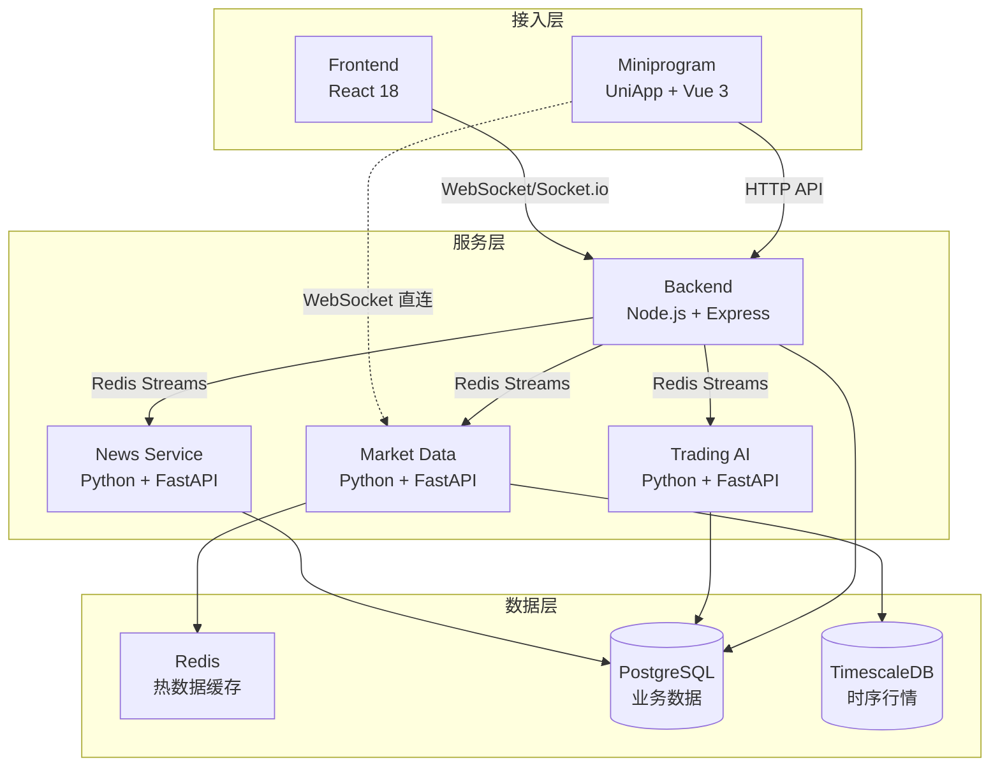

# Stock-Race · AI 股票竞赛平台

[](backend/tests)
[](market-data-service)
[](trading-ai-service)
[](miniprogram)

**你不是在炒股，你是在经营一家基金公司。**

Stock-Race 是一个 AI 驱动的股票竞赛平台。用户扮演"投资总负责人"，受"投资董事长"之托管理虚拟基金。你可以"招聘"来自不同"大学"（OpenAI、Anthropic、DeepSeek、百度、阿里、腾讯）的 AI 基金经理，让它们用真实的投资风格进行 PK。

---

## 🎮 核心概念

| 角色 | 定义 | 技术实现 |
|------|------|----------|
| **投资董事长** | 虚拟角色，设定投资目标 | 系统预设规则 |
| **投资总负责人** | 用户本人，管理基金公司 | JWT 认证 + 权限控制 |
| **AI 基金经理** | 不同大模型毕业的虚拟员工 | 6 大 AI 提供商统一适配 |
| **虚拟基金** | 用户指定的虚拟资金账户 | PostgreSQL + ACID 事务 |

**游戏化设计**：
- 基金经理有独特的"投资画像"（价值投资型、趋势跟踪型、量化型等）
- 通过对话引导，AI 自动提炼投资风格
- 实时排行榜展示各 AI 的收益表现
- 微信小程序支持"游客模式"，24h/72h 智能过期策略

---

## 🏗️ 架构亮点

### 六服务微服务架构



### 关键架构决策

**1. Redis Streams 事件总线** —— 解决服务间循环依赖

```yaml
# 消除 HTTP 调用循环，改为事件驱动
market:quote:realtime:     # 实时行情更新
news:intelligence:extracted:  # 新闻情报提取完成
ai:decision:made:         # AI 决策完成
trade:executed:           # 交易执行完成
```

- 支持消费者组，实现多实例负载均衡
- 消息持久化 + ACK 机制，确保不丢失
- 从轮询模式升级到事件驱动，延迟降低 80%

**2. 数据主权划分** —— "谁产生谁负责"

| 服务 | 数据主权 | 存储 |
|------|----------|------|
| Backend | 用户、账户、交易、持仓 | PostgreSQL |
| Market Data | 行情、技术指标 | TimescaleDB |
| News Service | 新闻、情报、情绪 | PostgreSQL |
| Trading AI | AI 画像、决策记录 | PostgreSQL |

**3. Miniprogram 混合分离方案**

```
实时行情（高频、低计算）          收益数据（低频、高计算）
┌──────────────┐                ┌──────────────┐
│ Market Data  │──WebSocket────►│ Miniprogram  │
│   10s 推送    │   无需认证      │   实时展示   │
└──────────────┘                └──────────────┘
                                        ▲
┌──────────────┐                ┌───────┴──────┐
│   Backend    │◄──HTTP API─────│ Miniprogram  │
│  计算收益     │   JWT 认证      │   查询展示   │
└──────────────┘                └──────────────┘
```

---

## 🛠️ 技术栈全景

### 前端（Web）
| 技术 | 版本 | 用途 |
|------|------|------|
| React | 18.2+ | UI 框架 |
| TypeScript | 5.0+ | 类型安全 |
| Vite | 5.0+ | 构建工具 |
| Redux Toolkit | 2.0+ | 状态管理 |
| Ant Design | 5.0+ | UI 组件库 |
| ECharts | 5.0+ | 金融图表 |
| Socket.io-client | 4.0+ | 实时通信 |

### 后端（Node.js）
| 技术 | 版本 | 用途 |
|------|------|------|
| Node.js | 20 LTS | 运行时 |
| Express.js | 4.18+ | Web 框架 |
| Prisma | 5.0+ | ORM |
| PostgreSQL | 15+ | 主数据库 |
| Redis | 7+ | 缓存/消息队列 |
| Socket.io | 4.0+ | WebSocket |
| Bull | 4.0+ | 任务队列 |

### AI 服务（Python）
| 技术 | 版本 | 用途 |
|------|------|------|
| Python | 3.11+ | 运行时 |
| FastAPI | 0.100+ | 高性能 Web 框架 |
| OpenAI SDK | 1.0+ | GPT 系列 |
| Anthropic SDK | 0.5+ | Claude 系列 |
| pandas | 2.0+ | 数据处理 |
| pandas-ta | 0.3+ | 技术指标 |

### 数据服务（Python）
| 技术 | 数据源 |
|------|--------|
| AkShare | 新浪财经、东方财富等 |
| Baostock | 历史 K 线数据 |
| Tushare | 基本面数据（免费版） |
| aiohttp | 异步 HTTP 采集 |

### 小程序（UniApp）
| 技术 | 版本 | 用途 |
|------|------|------|
| UniApp | 3.x | 跨平台框架 |
| Vue 3 | 3.3+ | 前端框架 |
| TypeScript | 5.0+ | 类型安全 |
| Pinia | 2.x | 状态管理 |
| uView Plus | 3.x | UI 组件库 |
| uCharts | 2.5+ | 图表库 |

---

## 🤖 AI 集成创新

### 6 大 AI 提供商统一适配器

```python
# 统一接口，无缝切换不同模型
adapters = {
    "openai": OpenAIAdapter(),      # GPT-4/GPT-3.5
    "anthropic": ClaudeAdapter(),   # Claude 3
    "deepseek": DeepSeekAdapter(),  # DeepSeek Chat
    "baidu": WenxinAdapter(),       # 文心一言
    "aliyun": QwenAdapter(),        # 通义千问
    "tencent": HunyuanAdapter(),    # 混元大模型
}
```

### Token 成本控制体系

| 阶段 | 机制 | 说明 |
|------|------|------|
| 预算估算 | 请求前预估 Token 数 | 超出预算拒绝请求 |
| 限额控制 | 单条 < 2000 tokens | 防止异常消耗 |
| 分级告警 | 日/周/月三级阈值 | 邮件 + 日志告警 |

### 基金经理画像自动提炼

```python
# 通过对话自动分析投资风格
async def extract_profile(dialogue_history: List[Message]) -> InvestorProfile:
    prompt = f"""
    分析以下对话，提炼基金经理的投资风格：
    - 风险偏好：保守/稳健/激进
    - 投资周期：短线/中线/长线
    - 偏好行业：科技/消费/金融等
    - 决策特点：量化驱动/基本面分析/情绪感知

    对话记录：{dialogue_history}
    """
    return await llm.generate(prompt)
```

### 数据融合决策

AI 决策时融合双源数据：
- **Market Data Service**: 实时行情 + 技术指标（MA/MACD/RSI/布林带）
- **News Service**: 新闻情绪分析 + 重大事件提醒

---

## 📊 数据管道设计

### 多源采集架构

```
┌─────────────────────────────────────────────────────────┐
│                    数据采集调度器                         │
├─────────────┬─────────────┬─────────────┬───────────────┤
│  新浪财经    │  腾讯财经    │  东方财富    │   Baostock   │
│  (优先级 1)  │  (优先级 2)  │  (优先级 3)  │  (历史数据)   │
└──────┬──────┴──────┬──────┴──────┬──────┴───────┬───────┘
       │             │             │              │
       └─────────────┴──────┬──────┴──────────────┘
                            ▼
              ┌─────────────────────────┐
              │     数据质量评估器        │
              │  - 价格范围验证          │
              │  - 涨跌幅异常检测        │
              │  - 时间戳过期检测        │
              │  - Z-score 异常检测      │
              └───────────┬─────────────┘
                          ▼
              ┌─────────────────────────┐
              │     三层缓存架构         │
              │  L1: Redis (10s TTL)    │
              │  L2: TimescaleDB (持久) │
              │  L3: 内存回退 (降级)    │
              └─────────────────────────┘
```

### 分层采集策略

| 层级 | 频率 | 覆盖范围 | 存储 |
|------|------|----------|------|
| 高频层 | 10 秒 | 热门 300 只 | Redis (10s TTL) |
| 低频层 | 60 秒 | A 股全量 5000+ | TimescaleDB |
| 历史层 | 日终 | 全部历史 | TimescaleDB + 归档 |

### 技术指标实时计算

- **移动平均线**: MA5, MA10, MA20, MA60
- **MACD**: DIF, DEA, Histogram
- **RSI**: 14 周期相对强弱指标
- **布林带**: 上轨/中轨/下轨

---

## 🧪 测试创新

### MCP 自动化测试框架

Claude Code 直接控制微信开发者工具，实现端到端自动化：

```yaml
# DSL 测试脚本示例
task: UC-V2-003
description: AI经理详情页收益曲线测试

test_flow:
  - action: navigate_to
    target: /pages/ai-manager-detail?id=123
  - action: wait_for
    selector: ".chart-canvas"
    timeout: 5000
  - action: screenshot
    name: "initial_load"
  - action: click
    selector: ".time-selector .week"
  - action: assert_screenshot
    baseline: "baseline.png"
    threshold: 0.05
```

### 4 个测试 Skill

| Skill | 功能 |
|-------|------|
| `/test-chart-render` | uCharts v2.x 图表渲染测试 |
| `/test-page-flow` | DSL 页面流程测试 |
| `/test-api-integration` | API 集成与网络监控测试 |
| `/test-snapshot-compare` | Pixelmatch 视觉回归测试 |

### Pixelmatch 图像对比

```typescript
// 截图对比示例
const result = await compareImages(
  'baselines/chart.png',
  'snapshots/chart.png',
  { threshold: 0.05, diffOutput: 'diff.png' }
);
// result.diffPercentage < 5% 判定为通过
```

---

## 👥 开发模式创新

### 多智能体协作架构

```
┌─────────────────────────────────────────────────────────┐
│                     首席架构师                           │
│              （架构决策 + 代码审查 + 协调）               │
└─────────────┬─────────────┬─────────────┬───────────────┘
              │             │             │
    ┌─────────▼─────┐ ┌─────▼─────┐ ┌────▼────┐ ┌────────▼──────┐
    │  前端智能体    │ │ 后端智能体 │ │ AI智能体 │ │  数据智能体   │
    │  (React/Vue)  │ │(Node.js)  │ │(Python) │ │  (Python)    │
    └───────────────┘ └───────────┘ └─────────┘ └───────────────┘
```

### Git Worktree 并行开发

```bash
# 多模块同时开发，互不干扰
module-dev backend              # 后端模块
module-dev frontend             # 前端模块
module-dev market-data-service  # 数据服务
module-dev trading-ai-service   # AI 服务
module-dev miniprogram          # 小程序
```

### 架构决策记录（ADR）

项目已记录 10 个关键架构决策：
- 001: 循环依赖解决方案（共享 Redis + 冷启动）
- 002: 事件总线风险分析（Redis Streams）
- 003: AI 对话服务职责划分（Backend 实现）
- 004: AI Service 双向依赖解耦
- 005: 小程序游客模式设计（三层 API + 智能过期）
- 006: Miniprogram 数据流优化（混合分离方案）
- 007: AI 决策服务广度查询需求确认
- 008: Redis 渐进式部署策略
- 009: 前端定位决策
- 010: AI 架构定位与演进路线图

---

## 🚀 快速开始

### 环境要求

- Docker 20.10+
- Docker Compose 2.0+
- Node.js 20+（本地开发）
- Python 3.11+（本地开发）

### 一键启动（推荐）

```bash
# 启动全服务联调环境（含热重载）
make integration

# 查看服务状态
make status

# 查看实时日志
make logs

# 健康检查
curl http://localhost:3001/api/health
curl http://localhost:8000/api/v1/health/
curl http://localhost:8001/health
```

### 端口映射

| 服务 | 主机端口 | 容器端口 |
|------|----------|----------|
| Backend | 3001 | 3001 |
| Trading AI | 8000 | 8000 |
| Market Data | 8001 | 8001 |
| Redis | 6380 | 6379 |
| PostgreSQL | 5434 | 5432 |
| TimescaleDB | 5433 | 5432 |

### 开发命令

```bash
# 启动基础设施（仅 Docker 数据库）
make up

# 停止所有服务
make down

# 重新构建镜像
make build

# 运行测试
npm run test        # Backend
cd miniprogram && npm run test  # Miniprogram DSL/Skill tests
```

---

## 📈 项目状态

### 生产就绪度

| 模块 | 状态 | 测试覆盖 |
|------|------|----------|
| **Backend** | 生产就绪 | 195 个单元测试通过 |
| **Market Data Service** | 生产就绪 | 96% 测试覆盖率 |
| **Trading AI Service** | 生产就绪 | 32 项功能测试通过 |
| **News Service** | 生产就绪 | 核心功能测试通过 |
| **Miniprogram** | uCharts v2.x 适配中 | DSL + Pixelmatch 测试框架就绪 |

### 当前重点工作

- **P0**: uCharts v2.x 图表组件升级（解决白屏问题）
- **P1**: 小程序 AI 经理详情页完善
- **P2**: Backend 公开 API 对接小程序排行榜/行情页

### 技术债务

- [ ] 事件总线 SDK 统一封装（C1 冲突方案实施）
- [ ] Redis Cluster 渐进式部署（O6 优化方案）
- [ ] 集成测试环境完善（9 个 Docker Compose 测试）

---

## 🗺️ 项目导航

```
stock-race/
├── backend/                 # Node.js + Express + Prisma
├── frontend/                # React 18 + Vite + Ant Design
├── trading-ai-service/      # Python + FastAPI + 6 大模型适配
├── market-data-service/     # Python + FastAPI + 多源采集
├── news-service/            # Python + FastAPI + DeepSeek 流式处理
├── miniprogram/             # UniApp + Vue 3 + Pinia + uCharts
├── infra/                   # 共享基础设施（事件总线 SDK）
├── docs/                    # 完整文档体系
│   ├── architecture/        # 架构设计（含 10 个 ADR）
│   ├── development/         # 开发规范
│   ├── deployment/          # 部署指南
│   └── miniprogram/         # 小程序专项文档
├── .claude/skills/          # 4 个 MCP 测试 Skill
└── Makefile                 # 统一命令入口
```

---

## 📚 核心文档

- [CLAUDE.md](CLAUDE.md) — 项目导航中心
- [六服务架构设计](docs/architecture/CURRENT/SERVICE_ARCHITECTURE.md)
- [统一数据平台架构](docs/architecture/CURRENT/DATA_PLATFORM.md)
- [技术栈详细文档](docs/architecture/CURRENT/TECH_STACK.md)
- [架构决策记录](docs/architecture/CURRENT/DECISIONS/)
- [小程序 MCP 测试指南](docs/modules/miniprogram/MCP_GUIDE.md)

---

## 🤝 协作模式

本项目采用 **Claude Code 多智能体协作** 开发模式：

1. **首席架构师**（Claude）负责架构决策、代码审查、任务协调
2. **专项智能体**负责各模块开发（前端/后端/AI/数据）
3. **Git Worktree** 支持多模块并行开发
4. **文档驱动** — 所有架构变更必须有 ADR 记录

---

## 📄 License

MIT License © 2026 Stock-Race Team

---

> **Built with ❤️ by Claude Code + Multi-Agent Collaboration**
