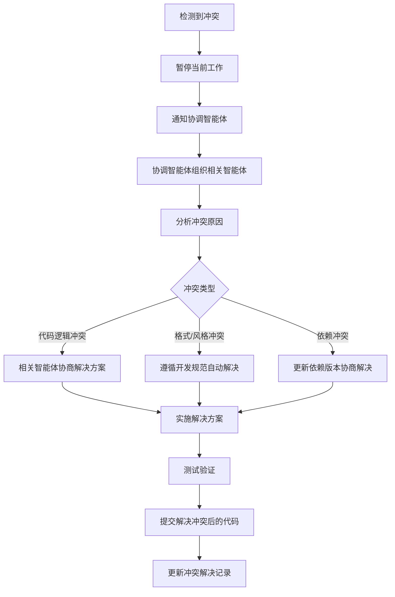
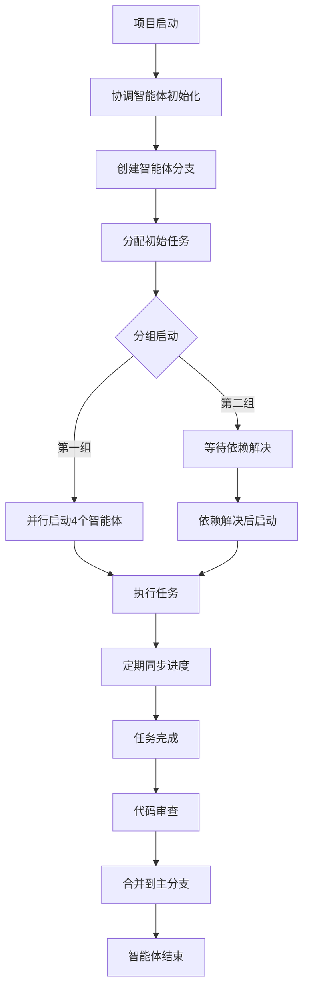
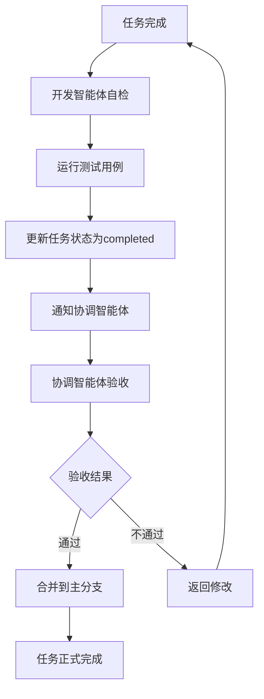

# 多智能体协作流程

## 📋 文档简介

本文件详细说明多智能体之间的 **信息传递机制**、**代码冲突处理**、**协作流程** 和 **验收标准**，旨在提高智能体间的协作效率，减少沟通成本，确保项目顺利进行。

**目标**：为智能体提供清晰的协作指南，确保多智能体并行开发时的顺畅协作。

## 🔄 信息传递机制

### 1. 文档化信息传递

| 信息类型 | 传递方式 | 存储位置 | 负责智能体 | 读取权限 |
|----------|----------|----------|------------|----------|
| **任务分配** | 文档更新 | `docs/agents/COLLABORATION_PLAN.md` | 协调智能体 | 所有智能体 |
| **进度更新** | 文档更新 | `docs/coordination/PROGRESS.md` | 协调智能体 | 所有智能体 |
| **技术方案** | 文档更新 | 对应模块文档 | 各智能体 | 所有智能体 |
| **问题报告** | 文档更新 + 直接沟通 | 对应模块TODO文档 | 各智能体 | 所有智能体 |
| **依赖变更** | 文档更新 | `docs/coordination/DEPENDENCIES.md` | 协调智能体 | 所有智能体 |

### 2. 实时信息传递

- **直接沟通**：智能体间可以通过系统提供的直接沟通机制进行实时交流
- **协调智能体中转**：对于跨多个智能体的问题，通过协调智能体进行信息中转和协调
- **紧急问题**：直接通知相关智能体和协调智能体，确保问题及时解决

### 3. 信息传递格式

#### 任务状态更新格式

```markdown
## 任务状态更新

### 智能体：[智能体名称]
### 日期：YYYY-MM-DD
### 当前状态：[pending/in_progress/completed/blocked]
### 完成情况：
- [x] 任务1
- [ ] 任务2
### 遇到的问题：
- 问题1描述
### 下一步计划：
- 计划1
- 计划2
```

#### 问题报告格式

```markdown
## 问题报告

### 报告智能体：[智能体名称]
### 日期：YYYY-MM-DD
### 问题类型：[编码/网络/逻辑/其他]
### 问题描述：
详细描述问题现象和影响
### 可能原因：
- 原因1
- 原因2
### 已尝试的解决方案：
- 方案1及结果
- 方案2及结果
### 需要的支持：
- 支持1
- 支持2
```

## 🔀 代码冲突处理与合并策略

### 1. 分支管理

- **主分支**：`main` - 稳定版本，仅接受已验证的合并
- **智能体分支**：每个智能体对应一个长期分支
  - `feature/be-utils` - 后端工具智能体
  - `feature/be-services` - 后端服务智能体
  - `feature/be-adapters` - 后端适配器智能体
  - `feature/fe-logic` - 前端逻辑智能体
  - `feature/fe-components` - 前端组件智能体
  - `feature/coordination` - 协调智能体

### 2. 冲突预防

- **模块化设计**：各智能体负责独立模块，减少代码重叠
- **定期同步**：智能体每天至少同步一次主分支代码
- **提前沟通**：对可能影响其他模块的修改，提前通知相关智能体
- **代码审查**：重要修改需要其他智能体代码审查

### 3. 冲突解决流程



### 4. 合并策略

- **智能体分支 → 主分支**：
  1. 确保智能体分支代码通过测试
  2. 同步主分支最新代码
  3. 解决可能的冲突
  4. 提交合并请求
  5. 协调智能体审核
  6. 审核通过后合并到主分支

- **智能体分支间合并**：
  - 仅在必要时进行（如共享工具类）
  - 合并前需通知相关智能体
  - 合并后更新依赖文档

### 5. 冲突解决记录

每次冲突解决后，相关智能体需在 `docs/coordination/CONFLICT_RESOLUTION.md` 中记录：
- 冲突日期和类型
- 涉及的智能体
- 冲突原因
- 解决方案
- 预防措施

## 📊 协作流程

### 1. 智能体启动流程



### 2. 日常协作流程

| 时间 | 活动 | 负责智能体 | 输出 |
|------|------|------------|------|
| **每日开始** | 查看进度更新和依赖变更 | 所有智能体 | - |
| **工作中** | 执行任务，遇到问题及时报告 | 所有智能体 | 代码修改、问题报告 |
| **每日结束** | 更新任务状态和进度 | 所有智能体 | 状态更新文档 |
| **每周五** | 周度进度汇总 | 协调智能体 | `PROGRESS.md` 更新 |
| **里程碑完成** | 阶段汇报 | 协调智能体 | `CLAUDE.md` 更新 |

### 3. 跨模块协作流程

当需要跨模块协作时（如编码工具优化后需要适配器智能体验证）：

1. **发起协作**：需求方智能体通知协调智能体和相关智能体
2. **制定计划**：协调智能体组织相关智能体制定协作计划
3. **执行协作**：按照计划执行跨模块任务
4. **验证结果**：验证跨模块功能是否正常
5. **更新文档**：记录协作过程和结果

## ✅ 验收标准

### 1. 代码验收标准

| 验收项 | 标准 | 验证方法 | 负责智能体 |
|--------|------|----------|------------|
| **功能正确性** | 代码实现符合需求，功能正常 | 运行测试用例 | 开发智能体 + 协调智能体 |
| **代码质量** | 符合编码规范，注释完整 | 代码审查 | 协调智能体 |
| **性能** | 响应时间合理，资源使用正常 | 性能测试 | 开发智能体 |
| **兼容性** | 与其他模块兼容，无冲突 | 集成测试 | 协调智能体 |
| **安全性** | 无安全漏洞，输入验证完整 | 安全审查 | 协调智能体 |

### 2. 文档验收标准

| 验收项 | 标准 | 验证方法 | 负责智能体 |
|--------|------|----------|------------|
| **完整性** | 文档内容完整，无缺失 | 文档审查 | 协调智能体 |
| **准确性** | 文档与代码一致，无错误 | 代码对比 | 协调智能体 |
| **可读性** | 文档结构清晰，易于理解 | 可读性审查 | 协调智能体 |
| **时效性** | 文档及时更新，反映最新状态 | 日期检查 | 协调智能体 |

### 3. 任务验收流程



## 🚨 紧急情况处理

### 1. 常见紧急情况

| 紧急情况 | 影响 | 处理流程 | 负责智能体 |
|----------|------|----------|------------|
| **代码冲突** | 阻塞开发 | 按冲突解决流程处理 | 相关智能体 + 协调智能体 |
| **网络问题** | 无法访问目标网站 | 检查网络连接，调整网络策略 | 后端服务智能体 |
| **编码问题** | 中文乱码 | 优化编码检测和转换逻辑 | 后端工具智能体 |
| **依赖冲突** | 构建失败 | 更新依赖版本，解决冲突 | 协调智能体 |
| **API变更** | 前后端通信失败 | 同步API变更，更新文档 | 相关智能体 + 协调智能体 |
| **并行限制违规** | 系统性能下降 | 立即检查运行中的智能体数量，暂停非关键智能体 | 协调智能体 |

### 2. 紧急情况上报流程

1. **立即通知**：相关智能体立即通知协调智能体
2. **评估影响**：协调智能体评估影响范围和严重程度
3. **组织解决**：组织相关智能体紧急解决
4. **更新状态**：实时更新问题解决状态
5. **预防措施**：制定预防措施，避免类似问题再次发生

## 📌 注意事项

- **并行限制**：智能体并行执行数量不超过四个，其他智能体串行执行
- **依赖关系**：严格遵循依赖关系，确保前序任务完成后再启动后续任务
- **代码审查**：重要代码变更必须经过代码审查
- **文档更新**：代码变更后必须及时更新相关文档
- **测试验证**：任何功能变更必须经过测试验证
- **上下文管理**：严格遵循 [上下文管理策略](CONTEXT_MANAGEMENT.md)，避免上下文超限

## 🗺️ 上下文管理集成

### 1. 智能体上下文限制

| 智能体类型 | 最大上下文限制 | 压缩触发点 | 结果摘要限制 |
|------------|----------------|------------|--------------|
| 主智能体 | 80k tokens | 70k tokens | - |
| 子智能体 | 70k tokens | 60k tokens | 2k tokens |

### 2. 协作流程中的上下文管理

1. **任务委派时**：主智能体仅传递与任务相关的最小上下文
2. **子任务执行**：子智能体遵循上下文分层机制，优先保留核心信息
3. **结果返回**：子智能体返回压缩后的结果摘要（限制在 2k tokens 内）
4. **结果整合**：主智能体只保留结果摘要，释放原始上下文
5. **定期检查**：每 10 轮交互后检查上下文大小，按需压缩

### 3. 紧急情况的上下文处理

- **上下文超限风险**：立即触发压缩操作，优先保留当前任务相关信息
- **重要信息丢失**：从压缩历史中恢复必要信息，确保系统功能完整性
- **协作中断**：使用标准化的结果格式，确保智能体间信息传递不中断

## 🔄 持续改进

### 1. 协作流程评估

- **每周评估**：协调智能体每周评估协作流程的有效性
- **问题收集**：收集智能体对协作流程的反馈
- **流程优化**：根据反馈持续优化协作流程

### 2. 工具支持

- **版本控制**：合理使用Git分支，定期提交代码，避免代码丢失
- **文档工具**：使用Markdown格式，保持文档结构清晰
- **沟通工具**：利用系统提供的沟通机制进行有效沟通

## 🎯 协调智能体增强功能

### 1. 并行限制监控

| 功能 | 描述 | 实现方法 |
|------|------|----------|
| **实时监控** | 实时跟踪运行中的智能体数量 | 每30秒检查一次智能体状态 |
| **启动控制** | 确保并行智能体数量不超过4个 | 智能体启动前检查运行数量 |
| **动态调整** | 根据系统性能调整启动顺序 | 基于CPU/内存使用情况 |
| **紧急干预** | 当并行数量超过限制时立即干预 | 暂停非关键智能体 |

### 2. 状态管理职责

1. **状态文件维护**：
   - 定期更新 `AGENT_STATUS.md` 文件中的智能体状态
   - 确保状态信息的准确性和时效性

2. **启动决策**：
   - 当运行中的智能体数量 < 4 时，启动等待中的智能体
   - 遵循依赖关系，确保智能体在依赖满足后启动
   - 考虑智能体优先级，优先启动高优先级任务

3. **依赖管理**：
   - 监控智能体间的依赖关系
   - 当依赖满足时，及时启动被阻塞的智能体
   - 处理循环依赖等特殊情况

4. **性能监控**：
   - 监控系统CPU、内存使用情况
   - 根据性能数据调整智能体启动策略
   - 避免系统过载

### 3. 智能体启动脚本集成

协调智能体将提供统一的智能体启动脚本，确保所有智能体遵循并行限制：

```bash
# 智能体启动脚本
function start_agent() {
  local AGENT_NAME=$1
  
  # 检查并行限制
  local RUNNING_COUNT=$(grep -c "running" docs/agents/AGENT_STATUS.md)
  if [ $RUNNING_COUNT -ge 4 ]; then
    echo "错误：并行智能体数量已达上限（4个）"
    echo "请等待其他智能体完成后再启动"
    return 1
  fi
  
  # 检查依赖
  if ! check_dependencies $AGENT_NAME; then
    echo "错误：依赖未满足"
    return 1
  fi
  
  # 更新状态并启动
  update_status $AGENT_NAME "starting"
  # 启动智能体...
  update_status $AGENT_NAME "running"
  
  return 0
}
```

---

*本文档最后更新于：2026-01-30*
*文档维护者：协调智能体*