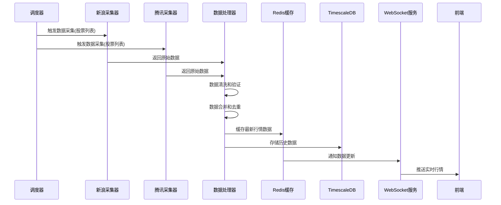
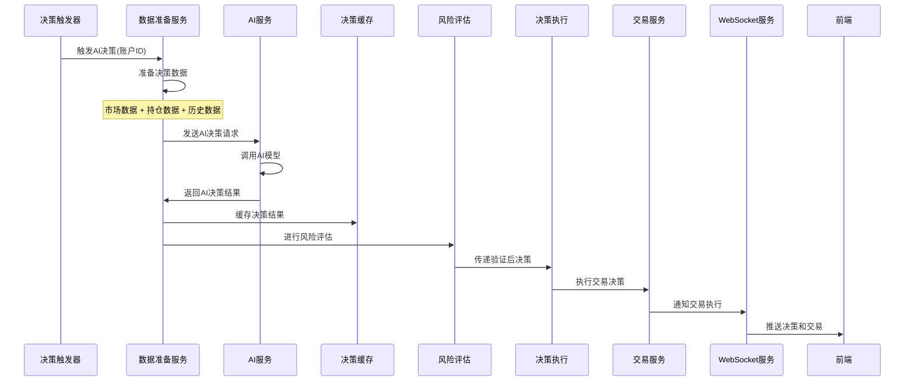
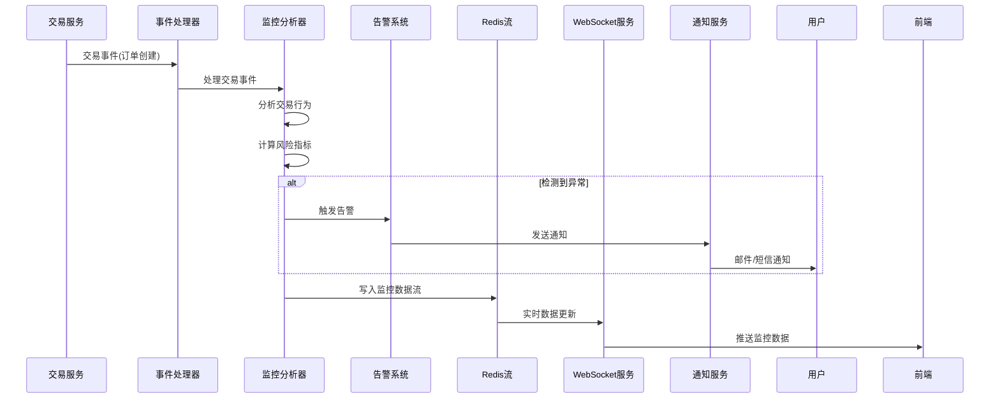

> ⚠️ **历史文档警告**
> 本文档为历史版本V1，创建于2026-02-03，已被后续版本取代。
> 最新数据流设计请参考 [CURRENT/SERVICE_ARCHITECTURE.md](../CURRENT/SERVICE_ARCHITECTURE.md)
> 统一数据平台架构详见 [CURRENT/DATA_PLATFORM.md](../CURRENT/DATA_PLATFORM.md)

---

# AI股票竞赛平台 - 数据流架构设计

## 1. 整体数据流概述

### 1.1 数据流设计原则
- **实时性优先**：股票行情数据延迟 < 5秒
- **数据一致性**：交易数据强一致性，行情数据最终一致性
- **容错性设计**：多数据源备份，故障自动切换
- **可扩展性**：支持数据量和用户量的线性扩展
- **监控告警**：全链路监控，异常自动告警

### 1.2 数据流架构图
```
┌─────────────────────────────────────────────────────────────────────────┐
│                             数据流架构总览                               │
├─────────────────────────────────────────────────────────────────────────┤
│                                                                         │
│  ┌─────────────┐    ┌─────────────┐    ┌─────────────┐                │
│  │  外部数据源  │    │  数据采集层  │    │  数据处理层  │                │
│  │             │    │             │    │             │                │
│  │ • 新浪财经   │───▶│ • 采集调度器 │───▶│ • 数据清洗   │                │
│  │ • 腾讯财经   │    │ • 多源采集   │    │ • 数据验证   │                │
│  │ • 东方财富   │    │ • 错误重试   │    │ • 数据转换   │                │
│  │ • 聚宽API   │    │ • 速率控制   │    │ • 数据存储   │                │
│  └─────────────┘    └─────────────┘    └──────┬──────┘                │
│                                                │                        │
│  ┌─────────────┐    ┌─────────────┐    ┌──────▼──────┐                │
│  │  AI决策流程  │    │  实时推送层  │    │  数据存储层  │                │
│  │             │    │             │    │             │                │
│  │ • 数据准备   │◀───│ • WebSocket │◀───│ • PostgreSQL│                │
│  │ • AI模型调用 │    │ • SSE推送   │    │ • Timescale │                │
│  │ • 决策生成   │    │ • 消息队列   │    │ • Redis缓存 │                │
│  │ • 风险评估   │    │ • 事件广播   │    │ • 文件存储  │                │
│  └──────┬──────┘    └──────┬──────┘    └─────────────┘                │
│         │                   │                                           │
│  ┌──────▼──────┐    ┌──────▼──────┐                                    │
│  │  交易执行层  │    │  前端应用层  │                                    │
│  │             │    │             │                                    │
│  │ • 订单验证   │    │ • 实时看盘   │                                    │
│  │ • 交易执行   │    │ • 交易监控   │                                    │
│  │ • 持仓更新   │    │ • 持仓展示   │                                    │
│  │ • 资金结算   │    │ • 分析报告   │                                    │
│  └─────────────┘    └─────────────┘                                    │
│                                                                         │
└─────────────────────────────────────────────────────────────────────────┘
```

## 2. 股票数据采集流程

### 2.1 数据采集架构
```
┌─────────────────────────────────────────────────────────────────────────┐
│                         股票数据采集流程                                 │
├─────────────────────────────────────────────────────────────────────────┤
│                                                                         │
│  ┌─────────────┐    ┌─────────────┐    ┌─────────────┐                │
│  │  定时触发器  │    │  采集调度器  │    │  数据采集器  │                │
│  │             │    │             │    │             │                │
│  │ • Cron任务   │───▶│ • 任务分发   │───▶│ • 新浪采集器 │                │
│  │ • 事件触发   │    │ • 负载均衡   │    │ • 腾讯采集器 │                │
│  │ • 手动触发   │    │ • 故障转移   │    │ • 东方采集器 │                │
│  └─────────────┘    └─────────────┘    └──────┬──────┘                │
│                                                │                        │
│  ┌─────────────┐    ┌─────────────┐    ┌──────▼──────┐                │
│  │  数据缓存层  │    │  数据处理层  │    │  数据存储层  │                │
│  │             │    │             │    │             │                │
│  │ • Redis缓存  │◀───│ • 数据清洗   │◀───│ • 原始数据   │                │
│  │ • 内存缓存   │    │ • 数据验证   │    │  临时存储    │                │
│  │ • 本地缓存   │    │ • 数据转换   │    │             │                │
│  └──────┬──────┘    └──────┬──────┘    └─────────────┘                │
│         │                   │                                           │
│  ┌──────▼──────┐    ┌──────▼──────┐                                    │
│  │  实时推送层  │    │  持久化存储  │                                    │
│  │             │    │             │                                    │
│  │ • WebSocket │    │ • Timescale │                                    │
│  │ • 消息队列   │    │ • PostgreSQL│                                    │
│  │ • 事件广播   │    │ • 备份存储  │                                    │
│  └─────────────┘    └─────────────┘                                    │
│                                                                         │
└─────────────────────────────────────────────────────────────────────────┘
```

### 2.2 数据采集时序图


### 2.3 数据采集策略
```python
# 数据采集配置
data_collection_config = {
    # 采集频率
    "frequency": {
        "real_time": "5s",      # 实时数据：5秒一次
        "minute": "1m",         # 分钟数据：1分钟一次
        "daily": "1d",          # 日数据：每日收盘后
    },

    # 数据源优先级
    "data_sources": [
        {
            "name": "sina",
            "priority": 1,
            "timeout": 10,
            "retry_times": 3,
            "rate_limit": "100/分钟"
        },
        {
            "name": "tencent",
            "priority": 2,
            "timeout": 10,
            "retry_times": 3,
            "rate_limit": "50/分钟"
        }
    ],

    # 股票列表
    "stocks": {
        "sh50": ["000001", "000002", ...],  # 上证50
        "sz50": ["000858", "000333", ...],  # 深证50
        "cyb50": ["300059", "300015", ...]  # 创业板50
    },

    # 故障处理
    "fault_tolerance": {
        "cache_duration": "5m",     # 缓存有效期5分钟
        "fallback_source": "tencent", # 备用数据源
        "alert_threshold": 3        # 连续失败3次告警
    }
}
```

### 2.4 数据处理流程
```python
class DataProcessor:
    def process_stock_data(self, raw_data):
        """处理股票数据"""
        # 1. 数据清洗
        cleaned_data = self.clean_data(raw_data)

        # 2. 数据验证
        if not self.validate_data(cleaned_data):
            raise DataValidationError("数据验证失败")

        # 3. 数据转换
        transformed_data = self.transform_data(cleaned_data)

        # 4. 数据增强
        enhanced_data = self.enhance_data(transformed_data)

        # 5. 数据存储
        self.store_data(enhanced_data)

        # 6. 数据推送
        self.push_to_cache(enhanced_data)

        return enhanced_data

    def clean_data(self, data):
        """数据清洗"""
        # 处理缺失值
        data = self.handle_missing_values(data)

        # 处理异常值
        data = self.handle_outliers(data)

        # 格式标准化
        data = self.normalize_format(data)

        return data

    def enhance_data(self, data):
        """数据增强"""
        # 计算技术指标
        data['technical_indicators'] = self.calculate_technical_indicators(data)

        # 计算财务指标
        data['financial_ratios'] = self.calculate_financial_ratios(data)

        # 添加市场情绪指标
        data['market_sentiment'] = self.calculate_market_sentiment(data)

        return data
```

## 3. AI决策流程

### 3.1 AI决策架构
```
┌─────────────────────────────────────────────────────────────────────────┐
│                           AI决策流程                                     │
├─────────────────────────────────────────────────────────────────────────┤
│                                                                         │
│  ┌─────────────┐    ┌─────────────┐    ┌─────────────┐                │
│  │  决策触发器  │    │  数据准备层  │    │  AI模型层    │                │
│  │             │    │             │    │             │                │
│  │ • 定时触发   │───▶│ • 市场数据   │───▶│ • OpenAI    │                │
│  │ • 价格触发   │    │ • 持仓数据   │    │ • Claude    │                │
│  │ • 事件触发   │    │ • 历史数据   │    │ • 文心一言   │                │
│  └─────────────┘    └─────────────┘    └──────┬──────┘                │
│                                                │                        │
│  ┌─────────────┐    ┌─────────────┐    ┌──────▼──────┐                │
│  │  决策缓存层  │    │  决策后处理  │    │  决策执行层  │                │
│  │             │    │             │    │             │                │
│  │ • Redis缓存  │◀───│ • 风险评估   │◀───│ • 决策解析   │                │
│  │ • 本地缓存   │    │ • 格式转换   │    │ • 逻辑验证   │                │
│  │ • 相似决策   │    │ • 日志记录   │    │ • 交易建议   │                │
│  └──────┬──────┘    └──────┬──────┘    └──────┬──────┘                │
│         │                   │                   │                        │
│  ┌──────▼──────┐    ┌──────▼──────┐    ┌──────▼──────┐                │
│  │  实时推送层  │    │  持久化存储  │    │  交易执行层  │                │
│  │             │    │             │    │             │                │
│  │ • WebSocket │    │ • PostgreSQL│    │ • 订单创建   │                │
│  │ • 消息队列   │    │ • 决策日志   │    │ • 交易验证   │                │
│  │ • 通知系统   │    │ • 分析报告   │    │ • 持仓更新   │                │
│  └─────────────┘    └─────────────┘    └─────────────┘                │
│                                                                         │
└─────────────────────────────────────────────────────────────────────────┘
```

### 3.2 AI决策时序图


### 3.3 AI决策数据准备
```python
class DecisionDataPreparer:
    def prepare_decision_data(self, account_id):
        """准备AI决策数据"""
        data = {
            # 账户信息
            "account": self.get_account_info(account_id),

            # 市场数据
            "market": {
                "watchlist": self.get_watchlist_prices(account_id),
                "market_trend": self.get_market_trend(),
                "sector_performance": self.get_sector_performance()
            },

            # 持仓数据
            "portfolio": {
                "positions": self.get_current_positions(account_id),
                "cash_balance": self.get_cash_balance(account_id),
                "total_value": self.get_portfolio_value(account_id),
                "performance": self.get_portfolio_performance(account_id)
            },

            # 历史数据
            "history": {
                "recent_trades": self.get_recent_trades(account_id, limit=20),
                "decision_logs": self.get_recent_decisions(account_id, limit=10),
                "price_history": self.get_price_history(account_id)
            },

            # 技术指标
            "technical": {
                "indicators": self.get_technical_indicators(account_id),
                "signals": self.get_trading_signals(account_id)
            },

            # 约束条件
            "constraints": {
                "trading_rules": self.get_trading_rules(account_id),
                "risk_limits": self.get_risk_limits(account_id),
                "position_limits": self.get_position_limits(account_id)
            }
        }

        return data
```

### 3.4 AI决策提示词模板
```python
class PromptTemplates:
    # 基础交易分析模板
    TRADING_ANALYSIS_TEMPLATE = """
    你是一个专业的股票交易AI助手。请基于以下信息进行分析并给出交易建议：

    ## 账户信息
    - 账户名称：{account_name}
    - 当前资金：{cash_balance} 元
    - 总资产：{total_value} 元
    - 风险偏好：{risk_level}
    - 交易频率：{trading_frequency}

    ## 市场情况
    {market_summary}

    ## 当前持仓
    {portfolio_summary}

    ## 近期交易记录
    {recent_trades}

    ## 分析要求
    请按照以下步骤进行分析：
    1. 技术面分析：基于价格走势和技术指标
    2. 基本面分析：基于公司基本面和行业情况
    3. 风险评估：识别潜在风险因素
    4. 交易建议：给出具体的买卖建议

    ## 输出格式
    请以JSON格式返回分析结果，包含以下字段：
    - recommendation: 建议操作（buy/sell/hold）
    - confidence: 置信度（0-1）
    - reasoning: 决策理由
    - risk_level: 风险等级（low/medium/high）
    - suggested_actions: 具体建议
    - target_price: 目标价格
    - stop_loss: 止损价格
    """

    # 风险评估模板
    RISK_ASSESSMENT_TEMPLATE = """
    请对以下交易决策进行风险评估：

    ## 决策信息
    {decision_info}

    ## 市场环境
    {market_environment}

    ## 风险评估维度
    请从以下维度进行评估：
    1. 市场风险：大盘走势、行业风险
    2. 个股风险：公司基本面、技术面风险
    3. 流动性风险：成交量、买卖价差
    4. 操作风险：交易执行风险

    ## 输出格式
    请以JSON格式返回风险评估结果
    """
```

## 4. 实时交易监控流程

### 4.1 交易监控架构
```
┌─────────────────────────────────────────────────────────────────────────┐
│                         实时交易监控流程                                 │
├─────────────────────────────────────────────────────────────────────────┤
│                                                                         │
│  ┌─────────────┐    ┌─────────────┐    ┌─────────────┐                │
│  │  交易事件源  │    │  事件处理器  │    │  监控分析器  │                │
│  │             │    │             │    │             │                │
│  │ • 订单创建   │───▶│ • 事件解析   │───▶│ • 异常检测   │                │
│  │ • 交易执行   │    │ • 事件分类   │    │ • 风险计算   │                │
│  │ • 持仓变更   │    │ • 事件分发   │    │ • 绩效计算   │                │
│  └─────────────┘    └─────────────┘    └──────┬──────┘                │
│                                                │                        │
│  ┌─────────────┐    ┌─────────────┐    ┌──────▼──────┐                │
│  │  告警系统   │    │  实时推送层  │    │  数据存储层  │                │
│  │             │    │             │    │             │                │
│  │ • 规则引擎   │◀───│ • WebSocket │◀───│ • 监控数据   │                │
│  │ • 告警触发   │    │ • 消息队列   │    │  存储        │                │
│  │ • 通知发送   │    │ • API推送   │    │             │                │
│  └──────┬──────┘    └──────┬──────┘    └─────────────┘                │
│         │                   │                                           │
│  ┌──────▼──────┐    ┌──────▼──────┐                                    │
│  │  用户通知   │    │  管理后台    │                                    │
│  │             │    │             │                                    │
│  │ • 站内消息   │    │ • 监控面板   │                                    │
│  │ • 邮件通知   │    │ • 告警管理   │                                    │
│  │ • 短信通知   │    │ • 报表查看   │                                    │
│  └─────────────┘    └─────────────┘                                    │
│                                                                         │
└─────────────────────────────────────────────────────────────────────────┘
```

### 4.2 交易监控时序图


### 4.3 监控规则配置
```python
class MonitoringRules:
    # 交易监控规则
    TRADING_RULES = {
        # 频率限制
        "frequency_limits": {
            "max_trades_per_minute": 10,      # 每分钟最多10笔交易
            "max_trades_per_hour": 50,        # 每小时最多50笔交易
            "cooling_period": 300             # 触发限制后冷却300秒
        },

        # 资金限制
        "capital_limits": {
            "max_position_size": 0.3,         # 单只股票最大仓位30%
            "max_daily_loss": 0.05,           # 单日最大亏损5%
            "min_cash_balance": 1000          # 最小现金余额1000元
        },

        # 价格限制
        "price_limits": {
            "max_price_deviation": 0.1,       # 最大价格偏差10%
            "min_trade_price": 0.01,          # 最小交易价格0.01元
            "max_trade_price": 10000          # 最大交易价格10000元
        },

        # 时间限制
        "time_limits": {
            "trading_hours": {
                "start": "09:30",
                "end": "15:00"
            },
            "holidays": ["2026-01-01", "2026-02-08"]  # 节假日
        }
    }

    # 风险监控规则
    RISK_RULES = {
        "position_risk": {
            "max_concentration": 0.5,         # 行业最大集中度50%
            "max_sector_exposure": 0.7,       # 板块最大暴露70%
            "min_diversification": 5          # 最少持有5只股票
        },

        "market_risk": {
            "max_beta": 1.5,                  # 最大Beta系数1.5
            "max_volatility": 0.3,            # 最大波动率30%
            "var_95": 0.05                    # 95%置信度VaR 5%
        },

        "liquidity_risk": {
            "min_volume_ratio": 0.001,        # 最小成交量比率0.1%
            "max_bid_ask_spread": 0.02,       # 最大买卖价差2%
            "min_trade_size": 1000            # 最小交易规模1000元
        }
    }
```

### 4.4 实时监控实现
```python
class RealTimeMonitor:
    def __init__(self):
        self.redis_client = RedisClient()
        self.websocket_server = WebSocketServer()
        self.alert_system = AlertSystem()

    async def monitor_trade_event(self, trade_event):
        """监控交易事件"""
        # 1. 解析交易事件
        trade_data = self.parse_trade_event(trade_event)

        # 2. 实时分析
        analysis_result = self.analyze_trade(trade_data)

        # 3. 风险检查
        risk_assessment = self.assess_risk(trade_data, analysis_result)

        # 4. 触发告警（如果需要）
        if risk_assessment['risk_level'] == 'high':
            await self.trigger_alert(trade_data, risk_assessment)

        # 5. 实时推送
        await self.push_realtime_update(trade_data, analysis_result)

        # 6. 数据存储
        self.store_monitoring_data(trade_data, analysis_result, risk_assessment)

        return {
            'trade_id': trade_data['id'],
            'analysis': analysis_result,
            'risk': risk_assessment
        }

    def analyze_trade(self, trade_data):
        """分析交易行为"""
        analysis = {
            # 频率分析
            'frequency': self.analyze_trading_frequency(trade_data),

            # 模式分析
            'pattern': self.analyze_trading_pattern(trade_data),

            # 绩效分析
            'performance': self.analyze_trade_performance(trade_data),

            # 异常检测
            'anomalies': self.detect_anomalies(trade_data)
        }

        return analysis

    async def push_realtime_update(self, trade_data, analysis):
        """推送实时更新"""
        update_data = {
            'event': 'trade:monitor',
            'data': {
                'trade': trade_data,
                'analysis': analysis,
                'timestamp': datetime.now().isoformat()
            }
        }

        # 推送到WebSocket
        await self.websocket_server.broadcast(update_data)

        # 写入Redis流
        await self.redis_client.xadd('monitoring_stream', update_data)
```

## 5. 数据存储与缓存策略

### 5.1 多级缓存架构
```python
class MultiLevelCache:
    def __init__(self):
        # L1: 内存缓存（最快）
        self.l1_cache = LRUCache(maxsize=1000)

        # L2: Redis缓存（分布式）
        self.redis_client = RedisClient()

        # L3: 数据库（持久化）
        self.database = DatabaseClient()

    async def get_stock_price(self, stock_code):
        """获取股票价格（多级缓存）"""
        # 1. 检查L1缓存
        price = self.l1_cache.get(stock_code)
        if price:
            return price

        # 2. 检查L2缓存（Redis）
        price = await self.redis_client.get(f'stock:{stock_code}:price')
        if price:
            # 回填L1缓存
            self.l1_cache.set(stock_code, price, ttl=10)
            return price

        # 3. 从数据库获取
        price = await self.database.get_stock_price(stock_code)
        if price:
            # 更新L2和L1缓存
            await self.redis_client.setex(
                f'stock:{stock_code}:price',
                60,  # 60秒过期
                price
            )
            self.l1_cache.set(stock_code, price, ttl=10)

        return price
```

### 5.2 数据同步策略
```python
class DataSyncManager:
    def __init__(self):
        self.message_queue = MessageQueue()
        self.database = DatabaseClient()
        self.cache = RedisClient()

    async def sync_trade_data(self, trade_data):
        """同步交易数据"""
        # 1. 写入数据库（主存储）
        await self.database.insert_trade(trade_data)

        # 2. 更新缓存
        await self.update_trade_cache(trade_data)

        # 3. 发布消息
        await self.publish_trade_event(trade_data)

        # 4. 触发下游处理
        await self.trigger_downstream_processing(trade_data)

    async def update_trade_cache(self, trade_data):
        """更新交易缓存"""
        cache_updates = [
            # 更新账户缓存
            (f'account:{trade_data["account_id"]}:trades:latest',
             trade_data['id'], 3600),

            # 更新股票缓存
            (f'stock:{trade_data["stock_code"]}:trades:latest',
             trade_data['id'], 3600),

            # 更新持仓缓存
            (f'portfolio:{trade_data["account_id"]}:{trade_data["stock_code"]}',
             self.calculate_position(trade_data), 300)
        ]

        for key, value, ttl in cache_updates:
            await self.cache.setex(key, ttl, value)
```

## 6. 容错与灾备策略

### 6.1 数据源容错
```python
class FaultTolerantDataCollector:
    def __init__(self):
        self.data_sources = [
            {'name': 'sina', 'priority': 1, 'client': SinaClient()},
            {'name': 'tencent', 'priority': 2, 'client': TencentClient()},
            {'name': 'eastmoney', 'priority': 3, 'client': EastMoneyClient()}
        ]

    async def get_stock_data(self, stock_code):
        """容错的数据获取"""
        errors = []

        for source in sorted(self.data_sources, key=lambda x: x['priority']):
            try:
                data = await source['client'].get_stock_data(stock_code)
                if self.validate_data(data):
                    # 记录成功的数据源
                    await self.record_success(source['name'])
                    return data
            except Exception as e:
                errors.append(f"{source['name']}: {str(e)}")
                # 记录失败
                await self.record_failure(source['name'])
                continue

        # 所有数据源都失败
        raise DataCollectionError(f"所有数据源都失败: {errors}")
```

### 6.2 灾备恢复流程
```python
class DisasterRecoveryManager:
    async def handle_database_failure(self):
        """处理数据库故障"""
        # 1. 切换到只读模式
        await self.switch_to_readonly_mode()

        # 2. 使用缓存数据提供服务
        await self.serve_from_cache()

        # 3. 尝试恢复数据库
        recovery_result = await self.attempt_database_recovery()

        if recovery_result['success']:
            # 4. 数据同步
            await self.sync_data_from_cache()

            # 5. 恢复正常模式
            await self.switch_to_normal_mode()
        else:
            # 6. 触发人工干预
            await self.trigger_manual_intervention()

    async def serve_from_cache(self):
        """从缓存提供服务"""
        # 关键数据从缓存获取
        critical_data = {
            'stock_prices': await self.get_stock_prices_from_cache(),
            'user_sessions': await self.get_user_sessions_from_cache(),
            'recent_trades': await self.get_recent_trades_from_cache()
        }

        # 限制功能
        restricted_features = {
            'trading': False,      # 暂停交易
            'registration': False, # 暂停注册
            'ai_decisions': False  # 暂停AI决策
        }

        return {
            'mode': 'degraded',
            'data': critical_data,
            'restrictions': restricted_features
        }
```

## 7. 性能监控与优化

### 7.1 关键性能指标
```python
class PerformanceMetrics:
    METRICS = {
        # 数据延迟指标
        'data_latency': {
            'stock_price': {'target': 5, 'unit': 'seconds'},      # 股票价格延迟<5秒
            'trade_execution': {'target': 1, 'unit': 'seconds'},  # 交易执行<1秒
            'ai_decision': {'target': 30, 'unit': 'seconds'}      # AI决策<30秒
        },

        # 系统性能指标
        'system_performance': {
            'api_response_time': {'target': 300, 'unit': 'ms'},   # API响应<300ms
            'database_query_time': {'target': 100, 'unit': 'ms'}, # 数据库查询<100ms
            'cache_hit_rate': {'target': 90, 'unit': '%'}         # 缓存命中率>90%
        },

        # 业务指标
        'business_metrics': {
            'trading_success_rate': {'target': 99, 'unit': '%'},  # 交易成功率>99%
            'ai_decision_accuracy': {'target': 70, 'unit': '%'},  # AI决策准确率>70%
            'system_availability': {'target': 99.5, 'unit': '%'}  # 系统可用性>99.5%
        }
    }
```

### 7.2 性能监控实现
```python
class PerformanceMonitor:
    async def monitor_data_flow(self):
        """监控数据流性能"""
        while True:
            # 收集各项指标
            metrics = await self.collect_metrics()

            # 检查阈值
            alerts = await self.check_thresholds(metrics)

            # 发送告警
            if alerts:
                await self.send_alerts(alerts)

            # 记录指标
            await self.record_metrics(metrics)

            # 等待下一个收集周期
            await asyncio.sleep(60)  # 每分钟收集一次

    async def collect_metrics(self):
        """收集性能指标"""
        return {
            'timestamp': datetime.now().isoformat(),
            'data_latency': {
                'stock_price': await self.measure_stock_price_latency(),
                'trade_execution': await self.measure_trade_execution_latency(),
                'ai_decision': await self.measure_ai_decision_latency()
            },
            'system_performance': {
                'api_response_time': await self.measure_api_response_time(),
                'database_query_time': await self.measure_database_query_time(),
                'cache_hit_rate': await self.measure_cache_hit_rate()
            },
            'resource_usage': {
                'cpu': psutil.cpu_percent(),
                'memory': psutil.virtual_memory().percent,
                'disk': psutil.disk_usage('/').percent
            }
        }
```

---

*文档版本：v1.0*
*创建日期：2026-02-02*
*最后更新：2026-02-02*
*维护者：架构设计智能体*